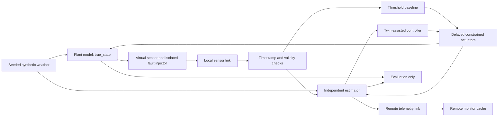

# Architecture

The numerical model is a pure function. The plant state and twin state are independently
allocated arrays with independent configured initial conditions. The orchestration layer is the
only component that advances both; neither estimator nor controller holds a plant reference.

Only one controller is active per run. The threshold controller uses the latest validated sensor
values and ages. The twin-assisted controller uses the estimator state and the time since a
usable observation. Both use the same hysteresis and actuator constraints. Truth is used for
sensor generation, plant propagation and evaluation only. Remote state never feeds local control.
The architecture test changes hidden plant initial conditions with all sensors missing and
checks that the twin trajectory is unchanged.

## Per-step timing

At left endpoint `k`, plant truth is `x[k]` and the twin holds its prediction for `k`:

1. Sample sensors and apply independent measurement noise, faults and dropout.
2. Send through the local link, including configured sensor delay; deliver due messages.
3. Reject future, nonfinite, out-of-bounds, expired, duplicate or out-of-order components.
4. Correct the twin with the latest accepted component from this delivery batch.
5. Send the current local estimate through the remote link and update its monitor cache.
6. Run the selected local controller, then process due actuator commands.
7. Record the three states, ages, commands, actual actions, weather and fault indicators.
8. Propagate the plant (with process disturbance) and twin (without disturbance) to `k+1`.

There are `N` trajectory rows and `N` integration intervals. `terminal_state.json` stores `x[N]`,
which is not included in left-endpoint metrics. Applied actuator feedback and current exogenous
weather are assumed known exactly by the estimator; that assumption is a research limitation.

## Link and actuator semantics

Local and remote links have separate queues, independent random streams and independent outage
windows. A message can be dropped at send or when due during a disconnection. There is no retry
or historical backlog replay. Age is checked at delivery; too-old packets are discarded. Jitter
can reorder messages; component timestamps prevent overwriting a newer reading with an older one.
After reconnection, fresh messages automatically update the remote cache. Each lifecycle records
generation, sending, scheduled reception, actual reception/resolution and a reason/status.
Undelivered messages at the run horizon are marked `pending_at_horizon`.

Each command is queued for its actuator delay. On its due step, failure windows freeze actual
actions. Otherwise each actuator changes only after its own minimum switching interval.
Rate-limited commands are recorded as `limited` and are not retried; later controller commands
can request the same change again. Failure freezes the current action, which may be nonzero.
Pending commands beyond the horizon are counted separately from failed commands.

## Modules

`config.py` validates configuration; `models/` contains equations, weather and actuators;
`sensors/` contains observation production and fault injection; `twin/` owns validation and
estimation; `control/` implements two policies; `communication/` models message transport;
`simulation/` orchestrates runs and artifacts; `experiments/` defines sweeps, metrics and paired
statistics; `visualization/` renders computed data. The optional `app.py` calls the same engine.

## 2.0 additions

The pre-sampling scheduler receives predicted state, available SD, prior health/ages, safe ranges
and local outage status. Sensor generation occurs only on sampling decisions; local sending has a
separate byte budget. All exogenous draws retain their original time index. Remote telemetry is
independent of this budget and still sent each step.

Delivered packets feed both timestamp validation and sensor health. Health uses model predictions
at generation time where EKF history exists (current prediction otherwise). The estimator factory
selects the two baselines or EKF/trust-EKF. Only trust-EKF uses health-adjusted R. Current health
memory does not rewind on reordered packets. EKF replay uses its own bounded generation-indexed
history rather than the threshold controller's latest-reading cache, which still rejects obsolete
updates to the active sensor display/cache. Transport expiry remains a separate earlier filter.

The controller consumes cached observations or estimates; an EKF uncertainty safeguard can mark
estimated channels invalid before calling the unchanged hysteretic control algorithm. Per-channel
validity and uncertainty flags explain fallback. Engine-generated evaluator labels are saved but
never passed to health/estimation/sampling. `health_events.csv`, `sampling_events.csv` and
`estimator_events.csv` are additive artifacts; historical v1 results remain readable without them.

External CSV replay is a separate information path: import/units/time sorting → selected partition
→ chronological delayed/masked packets → same health and estimator → measurement-consistency
metrics. It does not instantiate a plant, controller or synthetic true_state. The seven-workspace
Streamlit interface calls these same writers and loads completed artifacts, with explicit start,
configuration trace, saved-result restoration and failure diagnostics. See DATA_REPLAY.md.
